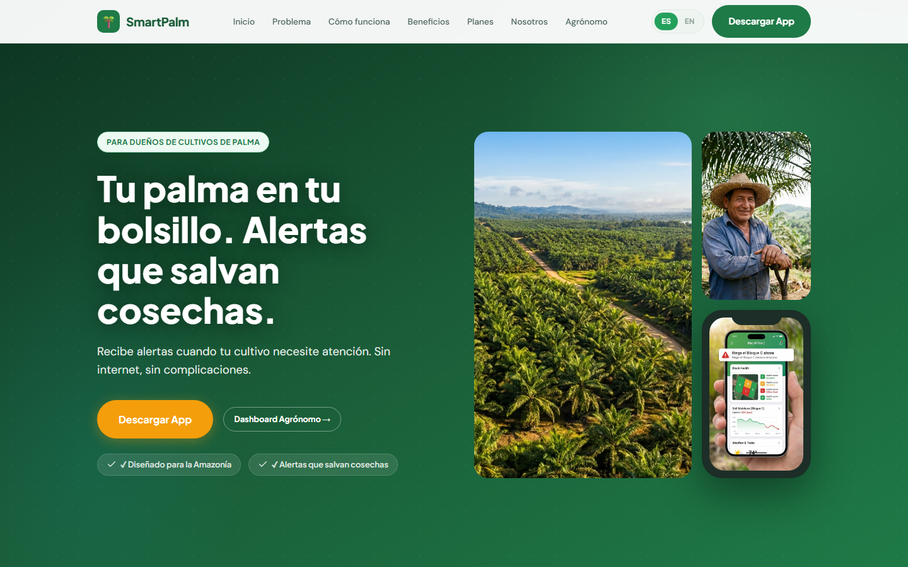
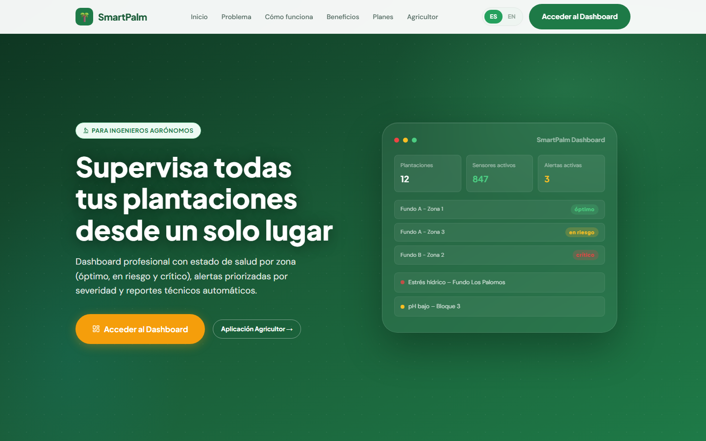

# SmartPalm

**Monitoreo de palma aceitera para la Amazonía peruana.** Sensores en campo, alertas de riego y plagas que llegan al celular del productor, y un panel técnico para el ingeniero agrónomo que supervisa varias plantaciones.

[](#stack-y-restricciones)
[](#stack-y-restricciones)
[](#stack-y-restricciones)
[](#ejecución-local)
[-2ea44f?style=flat-square)](#sistema-de-iconos)



---

## Índice

- [Qué es SmartPalm](#qué-es-smartpalm)
- [Arquitectura del sistema](#arquitectura-del-sistema)
- [Demo](#demo)
- [Stack y restricciones](#stack-y-restricciones)
- [Estructura del repositorio](#estructura-del-repositorio)
- [Ejecución local](#ejecución-local)
- [Arquitectura del front](#arquitectura-del-front)
- [Flujo de trabajo](#flujo-de-trabajo)
- [Equipo](#equipo)
- [Estado y despliegue](#estado-y-despliegue)
- [Créditos](#créditos)
- [Licencia](#licencia)

---

## Qué es SmartPalm

El pequeño productor de palma aceitera en la Amazonía decide cuándo regar y cuándo fumigar sin datos: no tiene sensores, no recibe alertas y depende de visitas técnicas espaciadas. SmartPalm convierte lecturas de humedad y temperatura del suelo en alertas concretas ("Riega el bloque C ahora") y entrega al agrónomo un panel con el estado de todas sus plantaciones.

El sitio cubre dos audiencias con páginas separadas:

| Página | Audiencia | Qué resuelve |
| :--- | :--- | :--- |
| `index.html` | Productor y dueño de fundo | Problema, cómo funciona, beneficios, planes (Semilla, Cosecha, Palma Pro) y contacto |
| `agronomo.html` | Ingeniero agrónomo | Dashboard multi-fundo, alertas priorizadas por severidad, reportes técnicos |
| `privacidad.html` | Legal | Política de tratamiento de datos |
| `terminos.html` | Legal | Términos y condiciones del servicio |

## Arquitectura del sistema

SmartPalm es un sistema de tres piezas. Este repositorio contiene la capa web.

| Componente | Responsabilidad | Estado |
| :--- | :--- | :--- |
| **Web** (este repositorio) | Landing pública, panel del agrónomo y páginas legales | Desarrollado |
| **Backend / API** | Lecturas de sensores, alertas, cuentas y reportes | Desarrollado |
| **App móvil** | Alertas y monitoreo en el celular del productor | Desarrollada |

Las tres piezas están construidas. Lo que resta es la publicación: al desplegar, la capa web consume los endpoints del backend y enlaza la app móvil desde sus llamadas a la acción.

## Demo

- **Panel del agrónomo:** <https://smart-palm.pages.dev/auth/login> (aplicación desplegada en Cloudflare Pages).
- **Landing pública:** se publica al desplegar el repositorio; mientras tanto se ejecuta en local (ver [Ejecución local](#ejecución-local)).
- **Video de presentación del equipo:** integrado en la sección "Conoce al equipo" de la landing.



## Stack y restricciones

| Capa | Tecnología |
| :--- | :--- |
| Estructura | HTML5 semántico, cuatro páginas estáticas |
| Estilos | CSS3 con custom properties, Flexbox y Grid, mobile-first |
| Interacción | JavaScript ES6+ en un único `app.js`, sin framework |
| Tipografía | Plus Jakarta Sans y DM Sans (Google Fonts) |
| Iconografía | Lucide (ISC) como sprite SVG inline |

**Restricciones asumidas a propósito en esta capa:** sin bundler, sin `package.json` y sin dependencias instalables.

El sitio se sirve desde cualquier hosting estático, se abre directamente desde el sistema de archivos y no tiene tiempo de compilación ni cadena de suministro que auditar. La lógica de negocio, la persistencia y las notificaciones viven en el backend y en la app móvil (ver [Arquitectura del sistema](#arquitectura-del-sistema)); la capa web los consume al publicarse.

## Estructura del repositorio

```text
.
├── index.html            Landing para el productor
├── agronomo.html         Landing y demo del panel para el agrónomo
├── privacidad.html       Política de privacidad
├── terminos.html         Términos y condiciones
├── style.css             Hoja de estilos única (tokens, componentes, media queries)
├── app.js                i18n ES/EN, navegación móvil, modales, animaciones
├── img/
│   ├── *.jpg|png         Fotos del equipo y de campo
│   └── support/          Imágenes de apoyo del hero y del dashboard
├── .github/assets/       Capturas usadas en este README
└── .gitignore
```

## Ejecución local

No hay instalación de dependencias. Dos formas:

```bash
# 1. Abrir directamente el archivo
#    (doble clic en index.html o arrastrarlo al navegador)

# 2. Servir por HTTP, recomendado para probar el comportamiento real
python -m http.server 8000
# luego abrir http://localhost:8000
```

El sitio funciona sin conexión salvo por dos recursos externos: las tipografías de Google Fonts y el enlace al panel desplegado.

## Arquitectura del front

### Internacionalización (ES/EN)

- El diccionario completo vive en `app.js`, una sola vez por idioma.
- Los elementos traducibles se marcan con `data-i18n="clave"`; `applyTranslations()` recorre esas claves y escribe el texto.
- `toggleLang()` cambia de idioma y persiste la preferencia en `localStorage` (`smartpalm_lang`).

**Regla del proyecto: un icono nunca vive dentro de un elemento `data-i18n`.** `applyTranslations()` asigna con `textContent`, que elimina todos los nodos hijos; un icono colocado dentro desaparecería en el primer cambio de idioma. El patrón correcto es hermano, no hijo:

```html
<a href="#" class="btn btn-amber btn-lg">
  <svg class="icon" aria-hidden="true" focusable="false"><use href="#i-smartphone"></use></svg>
  <span data-i18n="agro.video.cta">Descargar App</span>
</a>
```

### Sistema de iconos

Los iconos son SVG de [Lucide](https://lucide.dev) (licencia ISC), incrustados como sprite al inicio del `<body>` de cada página y consumidos por referencia:

```html
<svg class="icon" aria-hidden="true" focusable="false"><use href="#i-bell"></use></svg>
```

- El sprite es local: no hay CDN ni petición adicional, y `<use href="#id">` funciona incluso abriendo el archivo con `file://`.
- La clase `.icon` fija `width: 1em; height: 1em`, así que **el tamaño lo decide el `font-size` del contenedor** (`.problem-icon`, `.step-icon`, `.benefit-icon`, …). No hay tamaños duplicados en el CSS.
- Los iconos heredan el color del contexto mediante `stroke="currentColor"`.
- En contextos pequeños (`.plan-name`, `.plan-note`, `.popular-badge`, `.trust-badge`) se aplica un tamaño óptico de `1.25em` porque a menos de 12 px el trazo se empasta.

**Para agregar un icono:** descargar el SVG desde `lucide-static`, envolver sus trazos en `<symbol id="i-nombre" viewBox="0 0 24 24" fill="none" stroke="currentColor" stroke-width="2" stroke-linecap="round" stroke-linejoin="round">` dentro del sprite de la página, y referenciarlo con `<use href="#i-nombre">`.

### Componentes interactivos

| Componente | Detalle |
| :--- | :--- |
| Navegación móvil | `openMobileNav()` / `closeMobileNav()` sobre `.nav-hamburger` |
| Modal de contacto | Formulario que arma el mensaje de WhatsApp; guarda un historial local en `smartpalm_contactos` |
| Modal de ventas | `openSalesModal()` / `handleSalesSubmit()` para cuentas de más de 50 hectáreas |
| Animaciones de entrada | `IntersectionObserver` sobre `[data-animate]`; los elementos parten en opacidad 0 |

## Flujo de trabajo

| Rama | Propósito |
| :--- | :--- |
| `main` | Estado estable y publicable |
| `develop` | Integración del trabajo en curso |

- **Conventional Commits** (`feat`, `fix`, `refactor`, `chore`, `docs`) en inglés, con cuerpo explicando el *por qué* cuando el cambio no es evidente.
- **Commits atómicos:** una unidad de comportamiento por commit; tests, estilos y documentación de ese comportamiento viajan juntos.
- Los cambios llegan a `main` desde `develop`, no por push directo.

## Equipo

Proyecto del curso **Arquitectura de Software** — Ingeniería de Software, Universidad Peruana de Ciencias Aplicadas (UPC).

| Integrante | Código |
| :--- | :--- |
| Jeremy Alión Paucar Meneses | U201919449 |
| Victor Manuel Rojas Reategui | U202123655 |
| Camila Alessandra Conde Isla | U202114309 |
| Mauricio Rigoberto Muñoz Vilcapoma | U202217212 |
| Kenyi Efrain Ramirez Cabrera | U202220138 |

La documentación del producto (perfiles del equipo, capítulos de arquitectura y decisiones) vive en el repositorio [`smartpalm-report`](https://github.com/1ASI0728-Equipo2-Arquitectura-Software/smartpalm-report).

## Estado y despliegue

El sistema está desarrollado completo. Lo pendiente es la publicación y el enlace de sus piezas públicas.

| Elemento | Estado |
| :--- | :--- |
| Landing del productor | Desarrollada y bilingüe; pendiente de publicación |
| Landing del agrónomo | Desarrollada y bilingüe |
| Panel del agrónomo | Desplegado y accesible |
| Backend / API | Desarrollado; URL pública al desplegar |
| App móvil | Desarrollada; enlace público al desplegar |
| Video de presentación | Producido e integrado en la landing |
| Formulario de contacto | Funcional en cliente, con envío por WhatsApp |
| Pruebas | Verificación manual; sin suite automatizada |
| Licencia | Por definir (ver abajo) |

## Créditos

- Iconos: [Lucide](https://lucide.dev) — licencia ISC.
- Tipografías: Plus Jakarta Sans y DM Sans vía Google Fonts — SIL Open Font License.

## Licencia

Proyecto académico de la Universidad Peruana de Ciencias Aplicadas. El código se publica con fines de evaluación y portafolio; los derechos pertenecen a los autores y no se concede licencia de reutilización comercial. Para cualquier otro uso, contactar al equipo.
